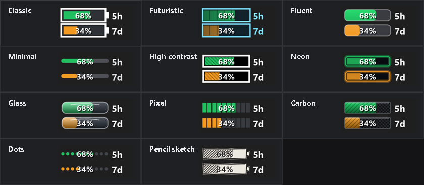
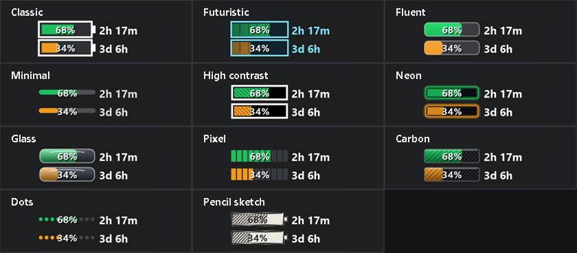
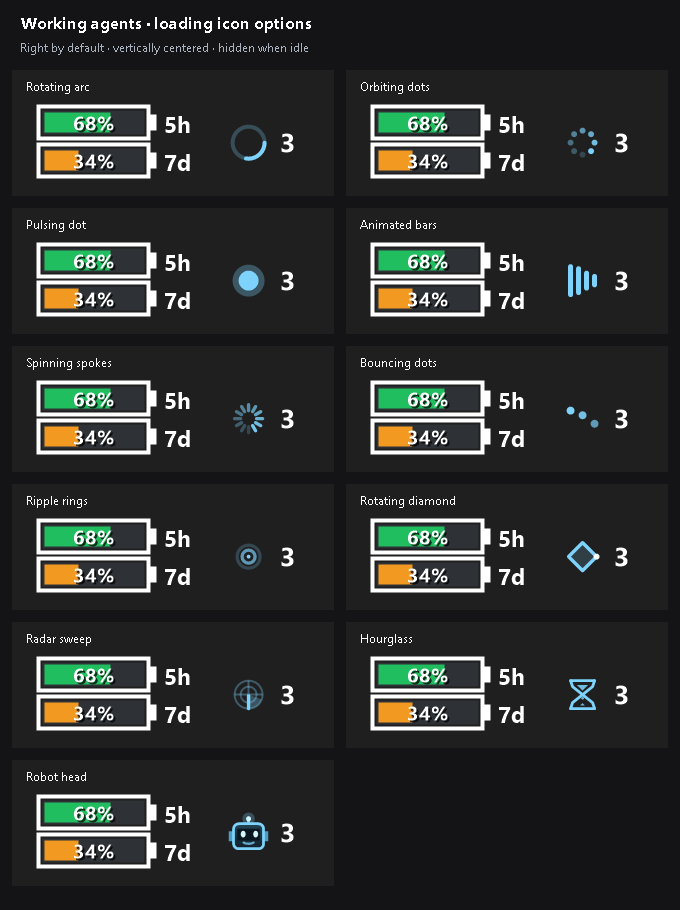
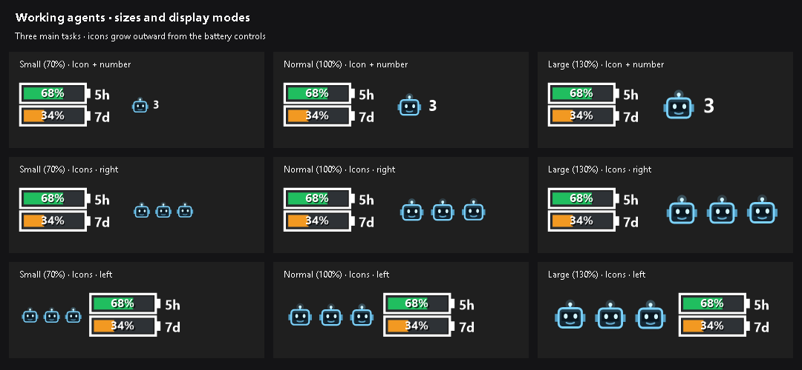
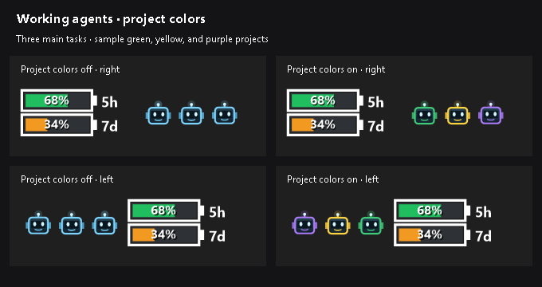
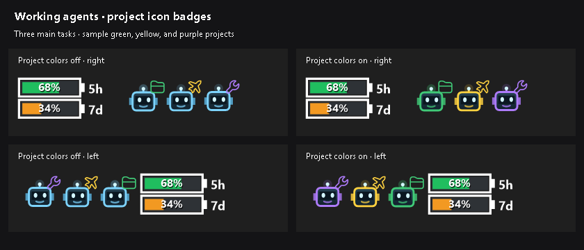

# Codex Usage Taskbar Widget (CodexTray)

Glanceable Codex usage batteries for the Windows taskbar.

CodexTray shows the remaining capacity of your 5-hour and weekly Codex usage
windows without opening Codex. It is a small native WinForms application: no
browser, no Electron runtime, no telemetry, and no model request on refresh.

This README describes the current `main` branch. Features listed under
[Unreleased](CHANGELOG.md#unreleased), including working-agent indicators, are
documented here before a versioned release is published. Build from source to
use unreleased features; check the changelog when using a release archive.





## Highlights

- Two filled battery gauges: 5-hour on top, weekly on the bottom
- Blue at 90% or above, green above 50%, orange above 25%, red above 5%,
  and purple for the last 5%
- Eleven battery styles: Classic, Futuristic, Fluent, Minimal, High contrast, Neon,
  Glass, Pixel, Carbon, Dots, and a color-independent Pencil-sketch meter
- Static `5h` / `7d` labels or live time-to-reset labels
- Optional percentages and left- or right-side labels
- Percentages centered in, or placed to the left or right of, the batteries
- Left, right, or per-monitor custom taskbar placement
- Live main-task activity with eleven loading-icon styles, including an
  animated robot head; hidden entirely when idle
- Optional sounds when main tasks stop, with nine bundled choices and a minimum runtime
- Separate question alerts with six Hmm/Huh voice clips, previews, and custom WAV support
- Counter at the far left or right (default), centered vertically, with optional
  animation and synchronization
- Working-agent icons use a fixed, large size for readability
- Icon and number, or one spaced icon per running main task, expanding outward
- Click a repeated task icon to bring Codex Desktop forward to that session
- Optional project colors for repeated task icons, matching Codex Desktop's palette
- Switchable project icon badges at the upper-right of repeated loading icons
- One widget on every connected display
- Settings and per-monitor positions remembered in the current user profile
- Optional start with Windows
- Usage refreshes every two minutes; agent activity is checked every second
- Transparent taskbar surface with event-driven z-order recovery after overlays
- Uses the existing local Codex sign-in; it never reads or stores credentials

The second gallery shows the live time-to-reset label mode: the top and bottom
labels show the remaining time in the current 5-hour and weekly windows.

## Install

### From a release

1. Download `CodexTray-win-x64.zip` from the repository's
   [Releases](https://github.com/GrzegorzO/CodexTray/releases) page.
2. Extract it to a permanent folder.
3. Run `CodexTray.exe`.
4. Right-click the tray icon and enable **Start with Windows** if desired.

The release build is self-contained, so a separate .NET installation is not
required. Windows may show a SmartScreen warning for unsigned community builds.
Review the source and release workflow before choosing **Run anyway**.

### Build from source

Requirements: Windows 10 or 11, the [.NET 10 SDK](https://dotnet.microsoft.com/download/dotnet/10.0),
and Codex Desktop or Codex CLI signed in locally.

```powershell
git clone https://github.com/GrzegorzO/CodexTray.git
cd CodexTray
dotnet restore
dotnet build --configuration Release
dotnet run --configuration Release
```

Create a single-file, self-contained executable:

```powershell
dotnet publish --configuration Release --runtime win-x64 `
  --self-contained true -p:PublishSingleFile=true `
  -p:IncludeNativeLibrariesForSelfExtract=true --output .\publish
```

## Use

The top battery is the 5-hour window; the bottom battery is the weekly window.
Battery width and color both represent the percentage remaining.

Right-click either the taskbar widget or notification-area icon:

| Menu | Options |
| --- | --- |
| **Show details** | Show percentages, reset times, and the running main-task count |
| **Refresh** | Request a usage update immediately |
| **Show this widget in taskbar** | Show or hide widgets on every monitor |
| **Display → Style** | Eleven classic, modern, accessible, and decorative styles |
| **Display → Position** | Left side, Right side, or Custom by dragging |
| **Display → Show labels** | Show or hide the label beside each battery |
| **Display → Label content** | Static window names or time remaining |
| **Display → Label position** | Labels on the left or right |
| **Display → Show percentages** | Show or hide percentage values |
| **Display → Percentage position** | Left, centered, or right with collision-free label spacing |
| **Display → Working agents → Show counter when working** | Enable or disable the activity indicator (enabled by default) |
| **Display → Working agents → Loading icon style** | Eleven activity-icon styles; Robot head by default |
| **Display → Working agents → Counter position** | Right of all controls (default) or left of all controls |
| **Display → Working agents → Display mode** | One icon per running main task (default), or icon and number |
| **Display → Working agents → Animate loading icon** | Enabled by default; turn off for a static icon |
| **Display → Working agents → Synchronize icon animations** | Off by default (staggered timing); enable to animate repeated icons together |
| **Display → Working agents → Use project colors** | On by default; available in One icon per task mode to color each icon by its task's project |
| **Display → Working agents → Show project icon** | On by default; add a small project-colored badge at the upper-right of each task icon, independently of loading-icon coloring |
| **Display → Working agents → Completion sound** | None (default), nine bundled sounds, or your own PCM WAV via **Choose custom WAV file...**; selecting a sound previews it |
| **Display → Working agents → Question sound** | None (default), six Hmm/Huh voice clips, or a separate custom WAV; alert once for a new structured question prompt |
| **Display → Working agents → Minimum runtime for completion sound** | 0, 10, 30 (default), or 60 seconds, or 5 minutes |
| **Start with Windows** | Toggle per-user automatic startup |

Dragging a widget horizontally switches that display to custom placement.
Display and placement settings are stored under `HKCU\Software\CodexTray`.
All display settings and per-monitor offsets are read again when the app starts.

Fresh configurations default to Neon batteries, countdown labels on the left,
centered percentages, and custom placement 8 pixels from the taskbar's left
edge. Working agents use animated Robot heads, one per task, with staggered
timing and project colors and badges enabled. Saved preferences take precedence.

The battery styles use familiar visual conventions: **Fluent** follows
[Windows' 4-pixel rounded bar geometry](https://learn.microsoft.com/en-us/windows/apps/design/signature-experiences/geometry),
**Minimal** uses a quiet determinate progress track, and **High contrast** combines
a strong outline with hatching so fill state is not communicated by color alone,
in line with [WCAG non-text contrast guidance](https://www.w3.org/WAI/WCAG21/Understanding/non-text-contrast.html).

### Working-agent indicators

The indicator is enabled by default and appears when a compatible local Codex
session has an in-progress turn. Nothing is shown at zero; this is normal when
Codex is idle. Open **Display → Working agents** to change its appearance.



The activity indicator shows an icon and the number of in-progress main Codex
tasks. Subagents and background helpers are excluded, so one main task with
several workers still shows `1`. Factory-dispatched workers share an active
controller's icon within the same factory project; workers running
without an active matching controller remain visible, including hidden sessions.
A main turn waiting on a tool, approval, or user input still counts until
completion or interruption. The indicator is vertically
centered beside the full battery, label, and percentage group. At zero, both the
icon and count disappear and the widget releases that space. Turning off animation
keeps the selected icon static.
Working-agent icons, count, and spacing use the former Large size (130% of the
original). This fixed size also applies to existing installations; earlier size
preferences are ignored and there is no size submenu. The usage batteries keep
their existing size. In **One icon per task** mode, two main tasks show two icons
with no number. Additional icons extend rightward on the right side and leftward
on the left side. The battery group stays anchored while space is available;
at a taskbar boundary the widget moves enough to fit.
Enable **Synchronize icon animations** to keep all repeated icons in the same
animation frame, including robot blinks and movement. Turn it off for staggered
timing. The preference is saved and takes effect immediately.

In **One icon per task** mode, enable **Use project colors** to use each main
task's Codex project color. Tasks in the same project share a color. Colors stay
with their task when icons expand on either side and refresh after a project is
recolored. Tasks without a resolvable custom project color keep the usual blue.
Icon-and-number mode keeps its usual color.

Enable **Show project icon** to add the project's selected marker at the upper-right
of each repeated loading icon. This separate switch works with **Use project
colors** on or off: the badge always uses the project color (usual blue when no
custom color is available). Badges stay still while the loading icons animate.
Named badges use the installed Codex Desktop app's vector shapes with transparent
backgrounds; built-in drawings cover unavailable or unsupported desktop assets.

Choose **Completion sound** to hear when a main task completes, is interrupted,
or exits after running for at least **Minimum runtime for completion sound**. Runtime means
the current turn, including tool and approval waits. Sound defaults to **None**,
and the minimum runtime defaults to **30 seconds**. Sounds work with the counter
or widget hidden. Stops detected in the same activity poll share one cue, and
historical completions are silent when CodexTray starts. Both preferences are saved.

Use **Completion sound → Choose custom WAV file...** to select your own
uncompressed PCM WAV. CodexTray validates and copies it into
`%LOCALAPPDATA%\CodexTray\sounds\custom-completion.wav`, selects it, and plays a
preview. The copy and selection survive restarts even if you move or delete the
original file. Switch back to it with **Custom WAV file**, or choose another file
to replace it. Canceling or selecting invalid audio keeps the previous selection.



Choose **Question sound** for an alert when Codex opens a structured question
prompt. It has six Hmm/Huh voice clips, immediate previews, a separately saved
custom WAV, and a silent default. Each new request alerts once; startup history,
duplicates, subagents, and hidden factory workers stay silent. A worker running
alone can alert. Question sounds work with the widget hidden, have no minimum
runtime, and take priority over a completion detected in the same poll.
Ordinary questions in chat text and approval requests are not detected.





These galleries are static previews. See the [working-agent guide](docs/working-agents.md)
for every default, all eleven icon styles, compatibility details, and troubleshooting.
Fullscreen video hides the widget only on the monitor whose taskbar is covered;
widgets on other visible taskbars should remain steady.

## How it works

Every two minutes, CodexTray starts the locally installed Codex app server,
performs its initialization handshake, and requests `account/rateLimits/read`.
This reads account quota state; it does not send a model prompt or consume Codex
tokens. The process is closed immediately after the response.

Agent activity is read separately from local Codex session lifecycle events and
thread writer locks under `CODEX_HOME` (or `%USERPROFILE%\.codex`). Session metadata
excludes subagent sources and parent-linked workers. An in-progress main turn
counts once; completion or interruption removes it. A released writer lock also
removes it, so a crashed Codex process cannot leave a phantom count. Loaded idle
threads do not count. This requires Codex's local writer-lock/session format;
remote/cloud-only tasks and sessions without those files are not included.
The local file format is a Codex implementation detail and can change between
versions; no minimum compatible Codex version has been established. If the files
are missing or incompatible, an absent indicator does not prove all agents are idle.
The monitor reads locally on a background thread and sends no model requests.
Animation runs only while a visible widget has a nonzero count.
Project coloring and factory-controller matching additionally read Codex Desktop's
local `.codex-global-state.json`. It uses task-project assignments, workspace hints,
and project roots. This desktop state format can change too; unavailable mappings
fall back to the normal blue and keep standalone factory workers visible.

CodexTray checks `CODEXTRAY_CODEX_PATH`, then `PATH`, then the Codex Desktop
installation below `%LOCALAPPDATA%\OpenAI\Codex\bin`.

Windows 11 does not provide a supported extension slot for an arbitrary custom
taskbar control. CodexTray therefore uses a compact, non-activating, topmost
window positioned over the selected taskbar area. Right-side placement detects
the primary notification-area boundary when Windows exposes it; custom dragging
is available when another taskbar layout needs adjustment.

When **Start with Windows** is enabled, a per-user Task Scheduler logon task
launches a small supervisor in your desktop session after a short delay. The
supervisor starts the widget and retries failed runs up to three times, one
minute apart. Choosing **Exit** ends both processes. The task runs on battery power and has no
runtime limit. It uses your normal Windows permissions and stores no password.
The task is named `CodexTray-<your Windows user SID>`.

Older Startup-folder shortcuts remain supported. To replace one with the new
task, turn **Start with Windows** off and on, or run the installed executable
with `--enable-startup`. The old shortcut is removed only after registration
succeeds. A task disabled in Task Scheduler appears unchecked in the app.

Startup diagnostics, including duplicate-instance exits and UI initialization,
are written to `%LOCALAPPDATA%\CodexTray\startup.log`. Task Scheduler also shows
the last run time and result, including failures before .NET reaches the app's
log. See [startup troubleshooting](docs/startup-troubleshooting.md).

## Privacy and security

- No analytics, telemetry, advertisements, or update service
- No direct reading of `auth.json`, API keys, passwords, or browser data
- Agent activity reads local Codex session logs, which can contain conversation
  content, to inspect session metadata and turn lifecycle events. CodexTray does
  not upload, save, or log that content, and does not change session-file contents.
- Project coloring, badges, and factory-controller matching read local desktop
  project metadata. It does not modify Codex's state or project settings.
- Project badges read named vector shapes from the installed desktop app's local
  archive without executing its JavaScript. Those assets are not bundled here.
- No model prompts or generation requests
- Network/authentication behavior is delegated to the installed Codex app server
- Display preferences remain in the current user's Windows registry hive

See [SECURITY.md](SECURITY.md) for vulnerability reporting and supported builds.

## Development

```powershell
dotnet format --verify-no-changes --no-restore
dotnet build --configuration Release --no-restore
dotnet run --configuration Release --no-build -- --self-test
dotnet run --configuration Release --no-build -- --print
dotnet run --configuration Release --no-build -- --print-activity
dotnet run --configuration Release --no-build -- --print-activity --project-colors
dotnet run --configuration Release --no-build -- --print-project-icons
dotnet run --configuration Release --no-build -- --export-screenshots .\docs\images
```

The project has no third-party runtime packages. CI builds and runs the self-test
on Windows for every push and pull request. Tags matching `v*` produce a
self-contained `win-x64` release archive.

See [CONTRIBUTING.md](CONTRIBUTING.md), [CHANGELOG.md](CHANGELOG.md), and the
[architecture notes](docs/architecture.md) for more detail.

## License

MIT. See [LICENSE](LICENSE).

Bundled completion sounds have separate CC BY 3.0, CC0, and MIT terms. See
[audio attribution](assets/sounds/ATTRIBUTION.txt) and the notices in
[assets/sounds/licenses](assets/sounds/licenses), also included in published builds.

CodexTray is an independent community project and is not affiliated with or
endorsed by OpenAI or Microsoft. Codex is a trademark of OpenAI.
