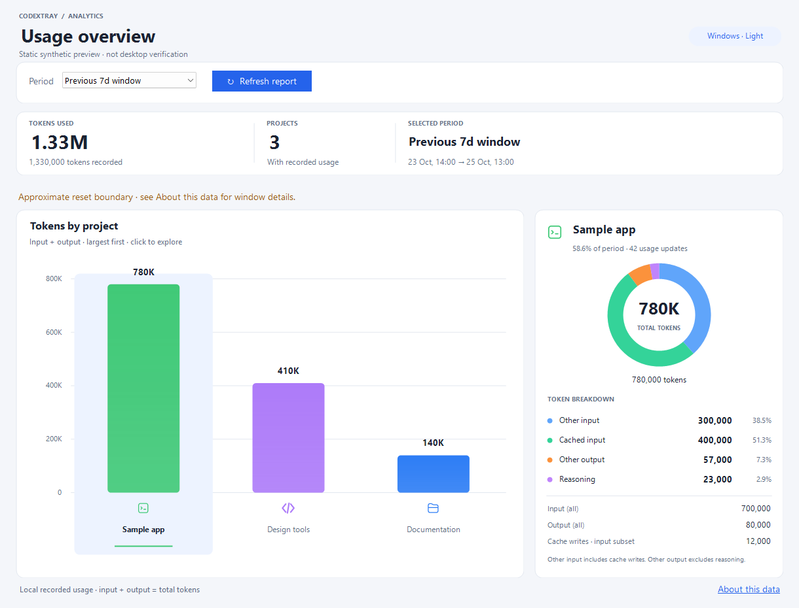
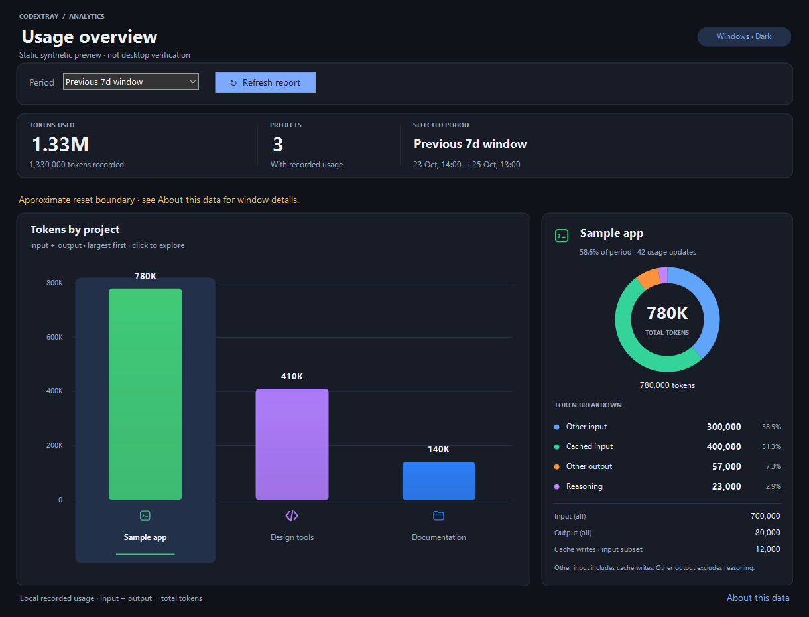
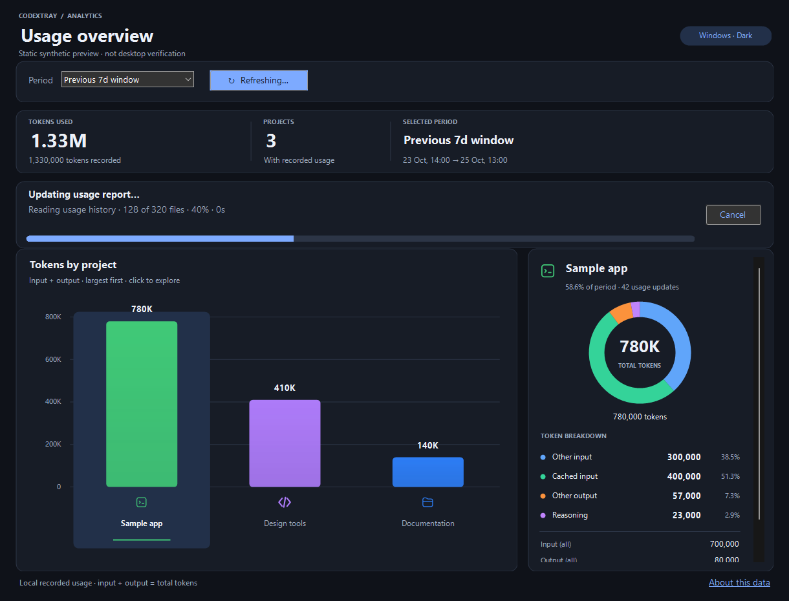
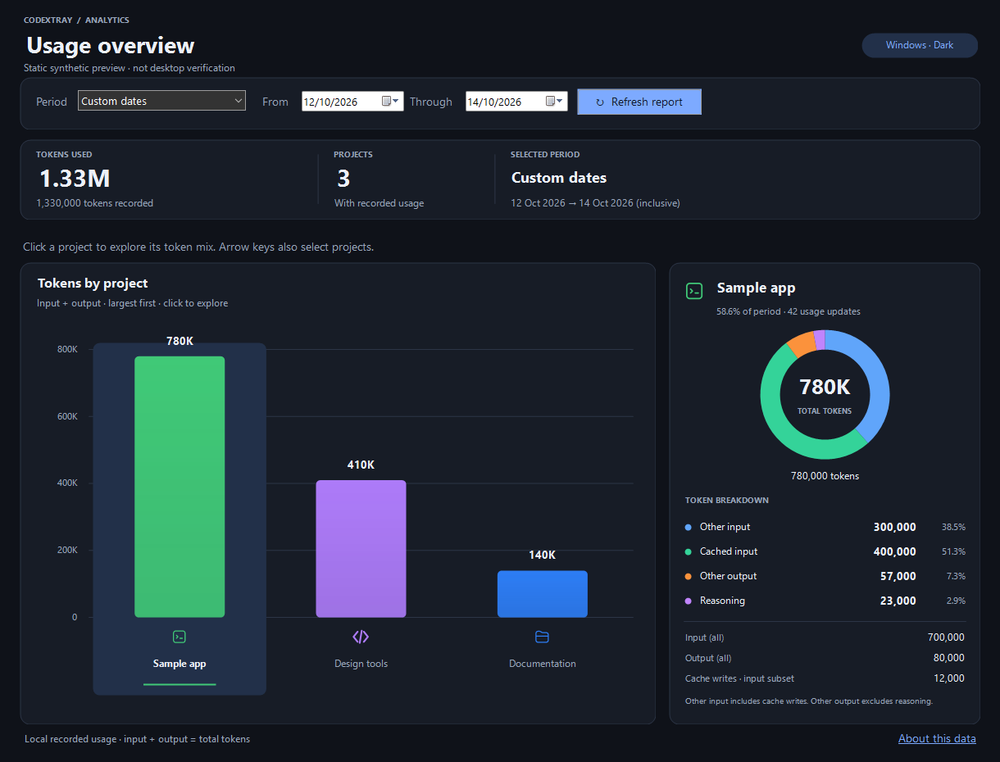

# Token usage reports

This guide describes current main-branch/unreleased behavior. Older release
archives may not include **Show usage report**.

Right-click either the taskbar widget or notification-area icon, then choose
**Show usage report**. The report is a native window; no browser is required.

## Periods and reset history

- **Current 5h window / Previous 5h window** use the 5-hour reset history.
- **Current 7d window / Previous 7d window** use weekly reset history.
- **Custom dates** includes both selected local calendar dates, from midnight on
  the start date to midnight after the end date. Daylight-saving days follow
  local Windows time rules. The summary shows the selected inclusive calendar
  dates; **About this data** shows precise timestamps with an exclusive end.

You can edit the custom dates in either order. If **Through** moves before
**From**, the start moves back to the selected end date. If **From** moves after
**Through**, the end moves forward to the selected start date. The edited
endpoint wins, so a same-day range remains valid and the report never refreshes
an intermediate inverted pair. Quota presets leave these hidden calendar values
alone; switching back restores your custom range for the lifetime of this window.

Presets request fresh reset metadata through the existing Codex app server. If
that request fails, the report labels its fallback to available reset history.
A normal start is inferred as reset time minus the nominal window duration.
Reset estimates within two minutes of the window's first observed reset time
are treated as corrections to the same window. They do not move its start to
the observation/report-generation time or manufacture a previous window.
The stable reference prevents a chain of small corrections drifting indefinitely.
When a larger reset change occurs before its old expiry, the previous window ends at the
first observation of that change. This can produce a two-day previous weekly
window. That observed boundary is approximate: a reset between records cannot
be located to its exact instant. The current window starts at that same observed
boundary. Records at the boundary belong to the new window.

The previous period is the last completed window established by available
observations. Missing observations can leave gaps or make a previous window
unavailable. The report never fabricates a preceding five-hour or seven-day
interval. Use custom dates when reset metadata is unavailable. The current window
may end in the future; only usage recorded up to report-generation time counts.

## Projects and token details

The dashboard follows **Windows app light/dark mode** automatically, including
changes while the report is open. High-contrast mode uses Windows system text
and surface colors. Native menus and controls use .NET's system color mode.
Summary cards show the total token count, project count, and selected period;
large values are abbreviated with the exact total underneath. The largest
project is selected when opening a report or changing to a period where the
previous selection is absent. Calendar filters appear only for **Custom dates**.

Every project with positive recorded usage gets its own vertical bar, sorted by
total tokens. Bars use the current Codex project color, with the project icon and
name beneath. Blue and a folder are fallbacks when appearance metadata is absent.
Scroll horizontally when many projects are present. Hover for the full project
identity and exact total; click a bar or label, or use left/right arrow keys, to
regenerate the report and inspect its details.

The selected-project panel includes a donut chart with four non-overlapping
slices: **Other input** (input minus cached input), **Cached input**, **Other
output** (output minus reasoning), and **Reasoning**. Legend rows show exact
counts and percentages of that project's total. Hover a slice or legend row for
its token count. The panel also shows **Input (all)**, **Output (all)**, and
**Cache writes**, keeping cache writes as a separately labelled input subset.
Other input includes cache writes; they are not added as another slice.

The slices sum to input + output. Cached input and reasoning are not counted
twice. Inconsistent subsets are capped to their parent totals for chart geometry
and labelled; **About this data** includes the original recorded counts. A zero
can mean zero usage or a missing field. Chart labels abbreviate large values;
legend counts and totals do not. The full project identity is available in
tooltips and **About this data** rather than as a large internal ID on the panel.

Projects are grouped by identity, so two projects with the same name remain
separate. Current explicit desktop assignments take precedence over directory
matching, including worktrees. Unassigned subagent worktrees can inherit a recorded
ancestor's project assignment. Standalone CLI workspaces fall back to full
directory identities and folder names; explicitly projectless tasks use **No
project**. Reassigning or renaming a project changes historical attribution on
the next generation because historical project assignments are not stored.

Changing periods or dates, selecting a project, clicking **Refresh report**, or
reopening **Show usage report** rebuilds the report from current local data.
The first scan can take longer with large session archives; unchanged files are
cached in memory. Project selection updates the visible breakdown immediately
while fresh data is read. A prominent loading panel and refresh state indicate work, and
the last completed view remains visible during refreshes or on a refresh failure.
New clicks cancel older requests so stale results do not replace the selected
report. Keyboard selection scrolls the chosen project into view. Smaller windows
let the chart and details scroll. Initial size is limited to the current display's
working area, and filters wrap on constrained screens. No polling runs while the
report is idle.

The loading panel starts immediately, shows elapsed seconds, and offers **Cancel**.
Its stages cover current-window lookup, history discovery, history reading,
and project/window calculation. History reading shows checked files and a
percentage based on discovered files, with byte progress within large files;
unchanged cached files count as checked too. The other stages animate without
inventing a percentage or ETA. Lookup/discovery runs off the UI thread, and
progress messages are throttled to keep the window responsive. A new request or
Cancel discards old updates. Cancellation preserves the last completed report.

## Coverage and privacy

The reader scans local `sessions` and `archived_sessions` rollout JSONL files
under `CODEX_HOME`, defaulting to `%USERPROFILE%\.codex`, with shared read access.
Unlike the activity counter, token reports include subagent usage. Repeated
cumulative notifications, copied pre-fork history, and archived duplicate session
IDs do not multiply recorded usage. Records without matching session metadata
are excluded; unfinished final lines are retried after the file changes.

The report is an account of available local token records, not account-wide
billing or per-project quota percentages. Remote-only, deleted, inaccessible,
unsupported, and missing history cannot be recovered. Observed file read failures
and malformed usage records are flagged on the dashboard and detailed under
**About this data**; absent directories or unsupported
records do not imply zero account usage. Token counts and quota percentages need
not have the same proportions across models or products.

Only usage and project/session metadata are retained in memory. Session files
can contain conversations, but their message content is not saved or logged by
the report. Project appearance/assignments come from local desktop metadata and
icons use the existing local vector reader. No credentials are read directly,
no model requests are made, and Codex state and session files are not modified.

## Reproducible preview and verification

Generate only this cropped report preview, using synthetic projects and counts:

```powershell
dotnet run --configuration Release --no-build -- --export-report-preview .\docs\images\usage-report.png
```

The command renders the report form offscreen without reading session/project
metadata or requesting quota metadata. Icons may use installed desktop vectors.
The command writes the light preview to the requested path and a dark preview
with `-dark` appended to its filename. Additional `-loading` and `-loading-dark`
images show a reproducible synthetic loading state. Additional `-custom` and
`-custom-dark` images show a valid custom range after editing the end first.
The full `--export-screenshots` command includes all six previews too.
Dates/numbers follow local Windows formatting.









`--self-test` covers token deltas, duplicates, fork baselines, incomplete writes,
archive duplication, distinct identities with equal names, project appearance,
subagent parent assignments, half-open ranges, reset-shortened windows, missing
history, fresh reset fallback, and cancellation. Presentation checks cover donut
partitions, capped inconsistent subsets, light/dark text contrast, bar/legend/
slice hit tests at 96/144/192 DPI, filter layout at minimum and constrained sizes, automatic
selection, keyboard selection with many-project scrolling, and empty reports.
Regression tests cover small reset-time corrections, previous-window stability,
weekly project coverage when its range contains the five-hour range, and progress
stages/cached-file counts. A synthetic WinForms message-loop test blocks quota
lookup on a worker and verifies that UI timers still run, the loading panel is
visible, and Cancel dismisses it safely.
Custom-date regressions exercise native picker change events in both edit
directions, valid and same-day ranges, round trips through all quota presets,
and the inclusive dates shown in the summary.
Interactive desktop theme changes, native calendar/dropdown flyouts, screen
readers, and scaling across physical monitors still require manual verification.

For a local window-boundary diagnostic, run `--print-report-windows`. It reads
current reset metadata and available local history, printing current five-hour,
current weekly, and previous weekly ranges and project counts. It does not print
project names, IDs, paths, conversations, or credentials.
