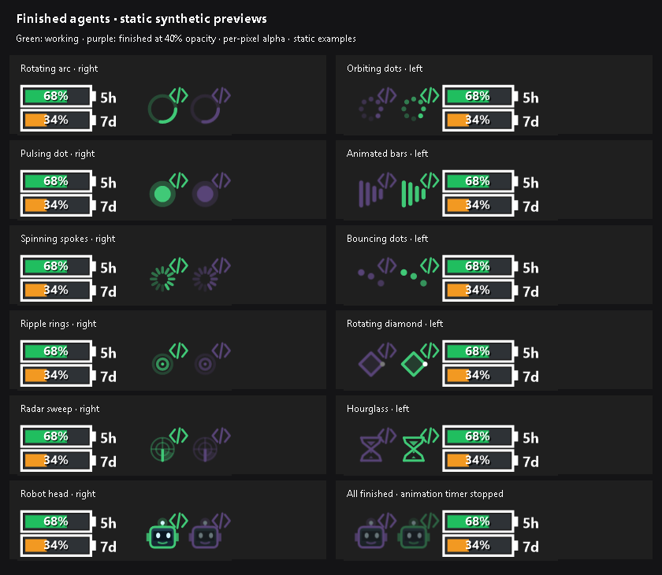
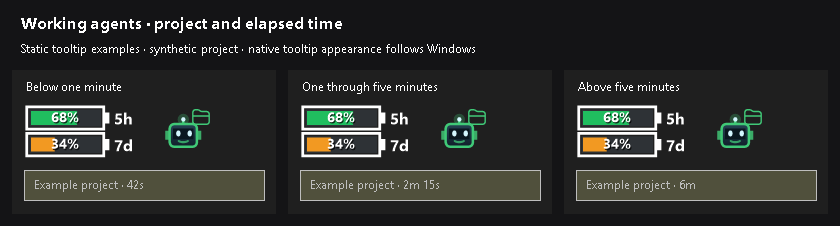

# Working-agent indicators

CodexTray can show how many local main Codex tasks have an in-progress turn.
Subagents and background helpers are excluded. The indicator sits beside the
usage batteries. **Icon and number** disappears completely at zero. **One icon
per task** keeps faded finished shortcuts until acknowledged, then releases the
space when no running or finished icons remain.
Copied parent history in a subagent log does not create an additional main-task
icon. Separate user-created chat forks still count as independent tasks.

This guide describes the current `main` branch. Check
[Unreleased in the changelog](../CHANGELOG.md#unreleased) before expecting these
options in an older release archive.

## Getting started

1. Run a build that includes working-agent indicators.
2. Start a task in a compatible local Codex Desktop or CLI session.
3. Right-click CodexTray's notification-area icon or its taskbar widget, then
   open **Display → Working agents**.
4. Leave **Show counter when working** enabled and choose the appearance you want.

The setting is enabled by default. When there are no running or retained finished
icons, use the notification-area icon to access Settings.

## Settings and defaults

All options below are under **Display → Working agents**. Changes apply
immediately to widgets on all monitors and are saved under
`HKCU\Software\CodexTray` for the next launch.

| Setting | Default | Behavior |
| --- | --- | --- |
| Show counter when working | On | Show running activity and, in repeated mode, retained finished shortcuts. Turning it off hides the activity indicator. |
| Loading icon style | Robot head | Choose from eleven styles, listed below. |
| Counter position | Right of all controls | Place the indicator outside the full battery, label, and percentage group. Left is also available. |
| Display mode | One icon per task | Show one icon per task, retaining faded finished shortcuts, or choose **Icon and number** for a running-task count. |
| Animate loading icon | On | Animate the selected style. Turn off for a static frame. |
| Synchronize icon animations | Off | Repeated icons use staggered timing by default. Turn on to put them in the same animation frame. |
| Use project colors | On | Available in **One icon per task** mode. Color each icon using its task's Codex project color. |
| Show project icon | On | Available in **One icon per task** mode. Show the project's marker as a small badge at the upper-right of each loading icon. |
| Completion sound | None | Choose nine bundled sounds or your own PCM WAV using **Choose custom WAV file...**. Selecting a sound previews it; None disables playback. |
| Question sound | None | Choose six Hmm/Huh voice clips or a separate custom PCM WAV. Selecting a sound previews it. Plays once for each new structured question prompt. |
| Minimum runtime for completion sound | 30 seconds | Choose 0, 10, 30, or 60 seconds, or 5 minutes. A turn lasting at least this long qualifies. |

Working-agent icons, numbers, and spacing always use the former Large size (130%
of the original). There is no size setting; earlier Small/Normal preferences are
ignored. The batteries keep their existing size.

The indicator remains vertically centered. There is no visible zero-state icon
or reserved gap once all running and retained finished icons are gone.

### Completion sounds

The selected sound plays when a main task completes, is interrupted, or releases
its writer lock after being observed working. The minimum runtime applies to
each turn, measured from its recorded start, including time waiting on tools,
approval, or user input. Each new turn starts its own runtime. Subagent stops
are excluded. Several stops detected in the same poll produce a single cue
across all monitors. Playback runs asynchronously.

Sound works with **Show counter when working** off, with the widget hidden,
and in either display mode. Historical completions found during initial discovery
or after a session file is truncated are silent. An already active turn retains
its recorded start time when CodexTray launches. Temporary session read failures
do not trigger sounds. Sessions first discovered after they have stopped cannot
notify. Preferences take effect immediately and persist across restarts.

**Choose custom WAV file...** opens a file picker for an uncompressed PCM WAV.
A valid file is copied to `%LOCALAPPDATA%\CodexTray\sounds\custom-completion.wav`
and immediately selected and previewed. CodexTray uses this saved copy after
restarts, so the original file can be moved or deleted. **Custom WAV file**
reselects the saved copy after using a bundled sound; its tooltip shows the
original filename. Choosing another custom file replaces the copy. Canceling
the picker or selecting invalid audio leaves the previous selection intact.

### Question sounds

Choose **Display → Working agents → Question sound** to enable an alert when
Codex opens a structured question prompt, including prompts with answer choices
or a free-text answer. The default is **None**. The six bundled cues are
Andrew — Hmm... and Ludvig, Royston, Brenda, Damien, and Daisy saying “Huh?”.
Selecting one previews it immediately. Removed bundled selections fall back to
None; existing custom WAV files and selections stay unchanged. See the bundled
audio attribution for sources and licenses.

Questions written only as ordinary chat text and permission/approval prompts
are not detected. Each recorded `request_user_input` or
`request_user_input_async` call alerts once, including questions that arrive
just before a turn finishes. Multiple new calls found in one poll share one cue
across all displays. If a completion is detected in that poll, an enabled
question sound takes priority. The minimum-runtime setting applies only to
completion sounds; question sounds do not wait for a minimum runtime.

Existing questions found at startup or after log truncation stay silent, as do
duplicate events, subagents, and factory workers hidden behind a controller.
Standalone factory workers can alert. Questions are checked even when the
counter or widget is hidden, and sound selections persist across restarts.

The custom question WAV is copied separately to
`%LOCALAPPDATA%\CodexTray\sounds\custom-question.wav`; choosing or replacing it
does not change your custom completion WAV. The same PCM validation and cancel
behavior applies to both menus. No question text is retained or logged.

### Display modes

With two in-progress main tasks, **Icon and number** shows one icon followed by `2`.
**One icon per task** shows two icons side by side, separated by a gap, with no
number. Each icon represents one main task, rather than its progress or
remaining work.

When an observed main turn completes, is interrupted, or releases its writer
lock, its repeated icon stays in the same slot as a static frame at 40% opacity.
The entire icon and project badge fade uniformly using per-pixel transparency:
their original colors blend into the actual taskbar behind them, without adding
white or a black background. Hover text shows **Finished** and the frozen turn
runtime. A finished-only strip stops its animation timer. The running count and
**Icon and number** mode exclude finished icons.

A successful click opens the session through Codex's existing link handler and
dismisses the finished shortcut across all monitors. Opening the chat directly
in Codex clears it when CodexTray observes a local unread-to-read transition.
Starting another turn in the same session removes the old shortcut and adds
the active icon at the outer edge, without duplicates. Dragging does not dismiss
or open it. Hidden counters and mode switches retain these in-memory shortcuts;
restarting CodexTray clears them. Historical completions found at startup or
after truncation do not create shortcuts. Sounds keep their independent settings.

Manual-open detection reads `electron-thread-read-state-v1` local unread flags
in `.codex-global-state.json`. Missing/unsupported metadata, partial writes, or
removed identity/host buckets do not dismiss shortcuts. A read transition that
happens entirely between polls may be missed; clicking the shortcut still works.
CodexTray never writes or marks a chat read in Codex's state files.



Hover over a task icon or its project badge to see its project name and elapsed
time for the current turn. The tooltip updates each second, including with icon
animation disabled: `42s` below one minute, `2m 15s` from one through five
minutes, and whole minutes such as `6m` once the runtime exceeds five minutes.
Runtime includes time waiting on tools or input and resets for each new turn.
Names follow the assigned project, including worktrees, independently of project
colors and badges. Without desktop metadata, the workspace folder name is used;
projectless tasks show **No project**. Hovering the usage batteries retains the
usage tooltip.



In **One icon per task** mode, left-click a task icon or its project badge to
bring Codex Desktop forward and select that session. This requires Codex Desktop
with its registered `codex://` link handler. The session must be available in
that desktop app. The aggregate **Icon and number** display has no session click
action. Dragging an icon still moves the widget without opening a chat;
double-clicking the usage batteries still shows usage details.

Additional icons extend outward from the battery group: rightward when the
indicator is on the right and leftward when it is on the left. Existing battery
and task icons keep their positions when new tasks appear, subject to available
taskbar space. Newly active tasks join the outer edge, including resumed tasks;
finished icons remain faded in place while the remaining task order is preserved.
The widget shifts when needed to fit within the available taskbar area.

Synchronization changes animation timing only. With synchronization on, robot
heads blink and bob together, and other styles share the same animation phase.
With it off, each repeated icon has an offset. In icon-and-number mode there is
only one activity icon, so the synchronization option has no visible effect.


### Project colors

Choose **Display mode → One icon per task**, then enable **Use project colors**.
Each icon uses its main task's project color from Codex Desktop's dark-sidebar
palette. Tasks in the same project use the same color; changing a project's
color updates its running icons on the next activity check. Synchronization
still controls animation timing independently of color.

Icons keep their task/color association on either side of the battery group.
The option is saved, starts on, and is unavailable in icon-and-number mode.
Switching back to icon-and-number mode leaves the single icon its usual blue.

A task's explicit project assignment takes priority, including when it runs in
a worktree. When no assignment is available, workspace hints and matching local
project roots can supply the mapping. The longest unambiguous root match wins.
Projectless tasks, default/unsupported project colors, missing metadata, or
unresolved project mappings fall back to the normal blue icon. These fallbacks
do not remove the task from the count.


### Project icon badges

Enable **Show project icon** to add a small, stationary project marker at the
upper-right of each repeated loading icon, with no background behind the symbol.
It has its own saved switch and works
independently of **Use project colors**. The badge always uses its project's color,
even when the loading icon keeps its normal blue. Projects with default or
unsupported colors use blue for the badge too.

CodexTray reads the installed desktop app's vector shapes for named project
markers, including its sidebar folder, planes, terminals, and wrenches. Vectors
are rendered directly at the widget's drawing scale, with no bitmap enlargement,
and use the full badge area for legibility. Emoji markers use a
monochrome Windows font glyph tinted with the project color. Projects without a
supported marker use a folder; unmatched and explicitly projectless tasks have
no badge. Badges scale with the loading icon and retain the same task association
on either side of the batteries. Switching them off restores the unbadged icon.

Desktop vectors are loaded from the installed app's local `resources/app.asar`
archive and cached in memory. CodexTray reads only icon data; it does not execute
the app's JavaScript or modify the installation. If the app is missing or its
asset format is unsupported, built-in drawings remain available as a fallback.
Restart CodexTray after a desktop update to reload its icons.


### Icon styles

Rotating arc, Orbiting dots, Pulsing dot, Animated bars, Spinning spokes,
Bouncing dots, Ripple rings, Rotating diamond, Radar sweep, Hourglass, and
Robot head are available. Robot head has blinking eyes, a glowing antenna,
and a gentle bob on a slower animation cycle.

These are separate from the eleven **Display → Style** options, which control
the appearance of the usage batteries.


## What the count includes

- Each main local task with a recorded turn start and no matching completion or
  interruption counts once while Codex still holds its thread writer lock.
- Subagents and background helpers, including Codex's guardian sessions, do not
  count. A main task and two working subagents produce a count of one.
- Session metadata identifies workers by a subagent source or a parent-task link.
  A manually forked main chat remains a separate main task and can count
  independently.
- Factory pipeline jobs with a structured dispatch prompt share the active main
  controller's icon when it belongs to the same factory project. Workers remain
  visible when the controller is idle, exits, or cannot be matched, including
  workers without a visible chat. Multiple standalone workers count separately.
  Matching uses desktop project assignments or the factory working directory,
  even when project colors and badges are disabled. Hidden worker completions
  do not play a sound.
- Turns waiting on tools, approval, or user input remain included until their
  completion or interruption is recorded. The count measures in-progress turns,
  not CPU activity.
- Open idle threads do not count. When the writer lock is released, for example
  after a Codex process exits, that thread is excluded.
- Every monitor shows the same count; having multiple widgets does not multiply it.

Activity is checked about once per second on a background thread. Discovery of
a new session can take a few seconds. The usage batteries have their own
two-minute refresh cycle; **Refresh** requests a quota update.

## Compatibility and local data

The activity monitor needs Codex's local `sessions` logs and `thread-writer-locks`
files, including session metadata identifying main tasks and workers. Sessions
without metadata are not counted. It looks under the `CODEX_HOME` environment
variable, or `%USERPROFILE%\.codex` when that variable is unset. CodexTray and Codex
must use the same local home directory. Restart CodexTray after changing `CODEX_HOME`.

These files are an implementation detail rather than a stable public status
API. No minimum compatible Codex version has been established. Changes to their
names, locking, or event format can affect detection independently of quota
display. Remote/cloud-only work, ephemeral sessions, and other sessions without
the required local files are not covered.

To resolve project names for tooltips, colors, badges, and factory worker
matching, CodexTray also reads
`.codex-global-state.json` from the same Codex home directory. It interprets
project names, colors and markers, task-project assignments, project-ID aliases, workspace
hints, and local project roots. The desktop state file is not modified. Its
format is also an implementation detail; incompatible or unavailable color
metadata falls back to blue. Codex CLI-only installations can still show the
main-task count without desktop project colors.

Project icon badges additionally read named vector assets from the local Codex
Desktop installation. These assets are not bundled with CodexTray.

Session logs can contain prompts, responses, and tool output. CodexTray reads
the files to interpret session type, parent links, lifecycle event types, turn
IDs, and structured factory dispatch headers in user messages. It keeps paths,
read offsets, current turn state, finished shortcuts, and local unread flags in
memory; it does not save, upload, or log conversation content, change session
contents, or read credential files.
Activity checks do not start a model request or consume Codex tokens.

## Troubleshooting

| Symptom | What to check |
| --- | --- |
| No indicator while Codex is idle | Expected when there are no retained finished shortcuts, or when Icon and number has a zero running count. |
| A faded icon remains after opening its chat | Manual dismissal needs an observed local unread-to-read transition. Missing metadata or transitions between polls can prevent detection; click the icon to open and dismiss it. |
| No indicator while a local task is running | Confirm the build includes this feature, **Show counter when working** is on, and CodexTray and Codex use the same `CODEX_HOME`. The session must have compatible local logs and writer locks. Missing indicators can mean unsupported activity, rather than zero activity. |
| A task waiting for approval still appears | Expected: its turn is still in progress. The count clears after completion, interruption, or release of its writer lock. |
| The count is higher than the number of chats being watched | Check for other local main tasks, including separate CLI sessions or manually forked main chats. Subagents and background helpers are excluded. |
| Icons do not animate together | Enable **Synchronize icon animations**. It is off by default and only has a visible effect with repeated icons. |
| Icons are static | Finished icons are always static. For running tasks, enable **Animate loading icon**. Animation stops while the widget is hidden or has no running tasks. |
| Use project colors is unavailable | Select **Display mode → One icon per task** first. The option does not apply to the single icon-and-number display. |
| Show project icon is unavailable | Select **Display mode → One icon per task** first. The switch is independent of Use project colors. |
| No badge on an otherwise working task icon | Confirm Show project icon is enabled and the task can be matched to a local project. Unmatched and explicitly projectless tasks have no badge. |
| A named project badge differs from the desktop icon | Run the project-icon diagnostic below. Unsupported or unavailable desktop assets use built-in fallback drawings. Restart CodexTray after updating Codex Desktop. |
| A task icon remains blue with project colors enabled | Confirm the project has a supported custom color in Codex Desktop and the app state is available under the same `CODEX_HOME`. Projectless, default-colored, or unmatched tasks intentionally use blue. |
| A widget disappears during fullscreen video | Expected on the monitor whose taskbar is covered. A visible taskbar on another monitor should retain its widget. Auto-hidden taskbars also hide their widgets. |
| The widget flickers on another monitor during fullscreen video | Use a build containing the fullscreen flicker fix. If it persists, report monitor layout, display scaling, video/browser details, and widget settings. |

From a source checkout, inspect the detected count without starting the UI:

```powershell
dotnet run --configuration Release -- --print-activity
```

To inspect resolved colors as well, add `--project-colors`:

```powershell
dotnet run --configuration Release -- --print-activity --project-colors
```

The diagnostic prints the count and an RGB color or `default` for each task in
its detection order. A fresh diagnostic does not share the running widget's
ordering history. It does not print task titles, project names, or working directories.

To check whether the installed desktop's named vector icons can be loaded:

```powershell
dotnet run --configuration Release -- --print-project-icons
```

A compatible installation reports `30/30`. An optional archive path after the
flag checks that specific local `app.asar` file instead of automatic discovery.

For a [public bug report](https://github.com/GrzegorzO/CodexTray/issues/new?template=bug_report.yml),
include the CodexTray build or commit, Codex version, display configuration,
selected activity settings, reproduction steps, and the diagnostic count.
Do not attach Codex session logs, credential files, or an entire `.codex` folder;
these can contain private conversation or account data. Screenshots should be
cropped to the widget and exclude private desktop information.
